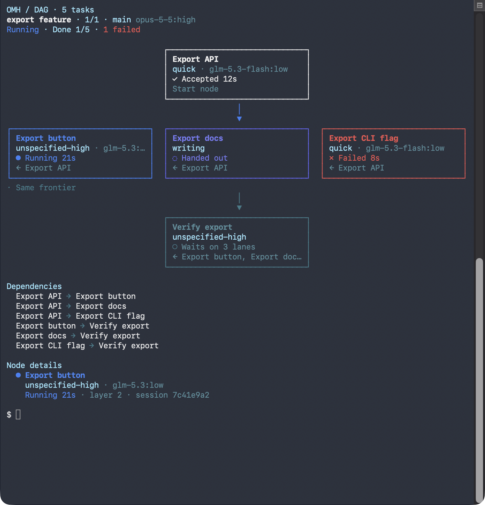
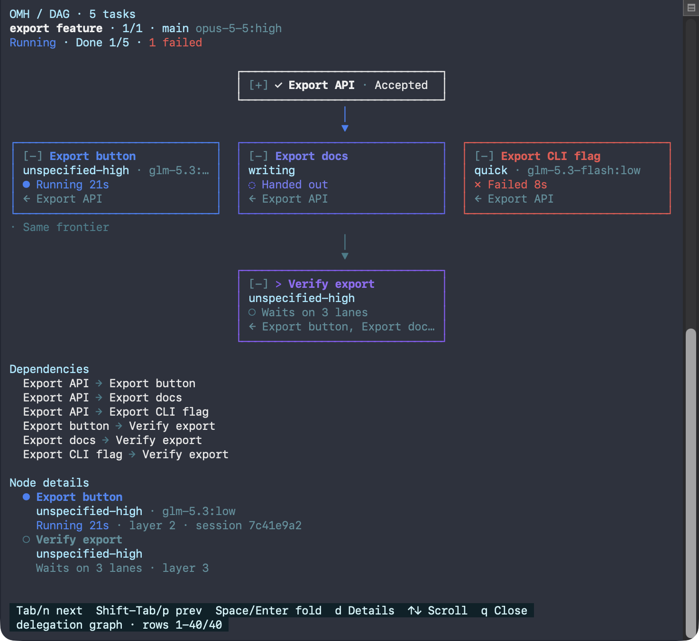
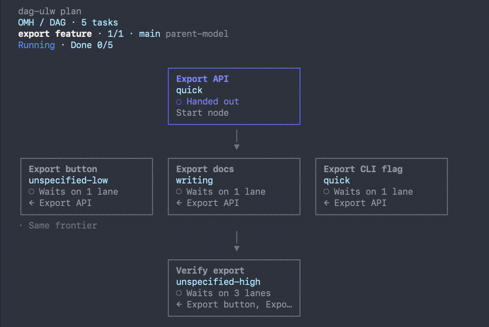

# Seeing What Coding Work Is Running

Multi-session coding work used to be invisible in three specific ways. Each is
now fixed, and each fix has a boundary worth knowing.

## What you get

```
Running work — 3 unit(s), 2 running

unit              runtime            model              status     elapsed   tokens       session
research-sweep    claude-code        opus xhigh         running    35m       10,000,000   sess_9f2c4a
api-ratelimit     codex              gpt-5.6-sol xhigh  running    4m        128,400      019a7b3e
docs-pass         omo-runtime (pi)   glm-4.6            completed  12m       unknown      unknown
```

Ask in chat — "what's running", "지금 뭐 돌고 있어", "what models are running" —
or run the command directly:

```sh
omh coding status-board [--limit N] [--json]
```

Below the units, the same board lists the work Hermes runs on its own: its
`delegate_task` children and its kanban board's tasks, read through the same
two readers the `omh_hud` tool uses (`hermes_delegation` over `state.db`,
`kanban_board_reader` over `kanban.db`). Both open the databases read-only. A
CLI board belongs to no conversation, so both answer in the global scope
`omh_hud` uses for an unmapped session.

```
Coding status board (3 running, 1 stuck of 7 observed) — observed at 2026-08-03T12:00:00Z
LABEL     RUNTIME  MODEL            STATUS          ELAPSED  TOKENS   TOOLS    SESSION
research  claude   🟠 fable-5 high  Code · running  35m      unknown  unknown  unknown
SOURCE           ID        MODEL                      STATE                   ELAPSED  TOKENS   TOOLS
hermes-delegate  childrun  ⚪ gpt-5.6-sol high        running                 2m       1,200    unknown  Fix the parser
hermes-kanban    aaaa0001  🟠 claude-sonnet-5 medium  running                 5m       3,400    7  Write the docs
hermes-kanban    bbbb0002  ⬜ unknown                 stale                   34m      unknown  unknown  Task t_bbbb0002
hermes-delegate  childend  ⚪ gpt-5.6-sol high        reported done           5m       1,200    unknown  Write the release note
hermes-kanban    cccc0003  ⬜ unknown                 queued (retry pending)  unknown  unknown  unknown  Task t_cccc0003
hermes-kanban    dddd0004  ⬜ unknown                 reported done           12m      unknown  unknown  Task t_dddd0004
```

- **SOURCE** says which reader the row came from; **ID** is Hermes' own (a
  child session's tail, a board task id). **STATE** is the reader's verdict,
  the same word the HUD shows, except that Hermes' `done` reads `reported done`:
  Hermes reported it, and OMH checked nothing.
- Rows run in the unit table's order: rows Hermes still calls running
  (`running`, `stale`) first, then by source and id.
- The headline counts units and Hermes workers together. A kanban lane whose
  heartbeat stopped (`stale`) is counted with the stuck units, not as running.
  In `--json`, `unit_count` / `running_count` / `stuck_count` stay the fanout
  tally, and `hermes_workers` carries its own `worker_count`, `running_count`,
  `stale_count`, `rows` and one `sources` record per reader.
- A Hermes database the board could not read is never shown as an empty
  source. Each `sources` record carries the reader's `read_status`, and
  anything but `read` prints its own line: `state.db` or `kanban.db` does not
  exist (`absent`), could not be read (`unreadable`), answered only some
  queries (`partial`), or the board path was refused as a symbolic link or an
  invalid board name and not opened (`refused`). The line names the file, never its local path.
- `--limit` caps each table on its own and states what it left out.
- Each reader selects a bounded number of rows (the newest delegate children,
  and the board's open lanes, running first). A reader that reached its bound
  sets `selection_capped`, and then every Hermes count on the board reads as a
  lower bound (`at least 96 running of at least 96 observed`). A line also
  names the source that was read only up to its limit.
- A lane that never started (Hermes creates some tasks already `blocked`) has
  no elapsed time: the reader reports `None` and the board prints `unknown`,
  never `0s`. A queued lane's elapsed is `unknown` too, as the HUD leaves it
  blank.

Both renderers take a `locale`: `render_status_board_text(payload, locale=...)`
for the aligned board and `status_board_messenger_body(payload, locale=...)`
for a chat surface. The copy comes from `src/catalogs/briefing_vocabulary.py`
and answers every locale either locale set uses — the four `--language` accepts
and the three more the chat-copy set resolves from a message. The CLI does not
yet pass one, so the command still prints English; an adapter that already
knows its reader's language can pass it today.

## The delegation graph

What the delegated work of one conversation looks like as a graph: who started
whom, and, for parts with recorded dependencies, what waits on what. A header
names the task count, the run and its state; then the nodes stand in
frontiers, a node's frontier being the longest path of recorded edges that
leads to it, and what comes after a repaired node (a node that depends on it,
or an extend its check added) standing below that node's repair, which ran
first. Each node is a box of four lines: its title, its category and
model with effort, its status with its glyph and duration (then the output
tokens its child has written, `· ↓1.2k`, where the box has room), and its
parents (`← Export API`) or `Start node`. The nodes of one frontier sit side by side
over a `· Same frontier` label, and one connector joins a frontier to the
next. Under the boxes, `Dependencies` lists every edge between two nodes, its
kind named unless it is a `depends_on`, and `Node details` gives a card to
each running or stuck node, and in `/dag` to the highlighted one: its whole
title, category and model, status and output tokens (`↓1.2k tokens`), group
and session. Main, the parent
session, is no box: the nodes it dispatched read `Start node`, and its model
is on the header's second line. A node added mid-run carries `↻ ` (a repair)
or `+ ` (an extend) before its title. A dag run of five nodes, at 100 columns,
as `omh hud --graph` prints it, and as a dark terminal paints it:



```text
OMH / DAG · 5 tasks
export feature · 1/1 · main opus-5-5:high
Running · Done 1/5 · 1 failed

                                  ┌──────────────────────────────┐
                                  │ Export API                   │
                                  │ quick · glm-5.3-flash:low    │
                                  │ ✓ Accepted 12s               │
                                  │ Start node                   │
                                  └──────────────────────────────┘
                                                  │
                                                  ▼
┌──────────────────────────────┐  ┌──────────────────────────────┐  ┌──────────────────────────────┐
│ Export button                │  │ Export docs                  │  │ Export CLI flag              │
│ unspecified-high · glm-5.3:… │  │ writing                      │  │ quick · glm-5.3-flash:low    │
│ ● Running 21s                │  │ ◌ Handed out                 │  │ ✗ Failed 8s                  │
│ ← Export API                 │  │ ← Export API                 │  │ ← Export API                 │
└──────────────────────────────┘  └──────────────────────────────┘  └──────────────────────────────┘
· Same frontier
                                                  │
                                                  ▼
                                  ┌──────────────────────────────┐
                                  │ Verify export                │
                                  │ unspecified-high             │
                                  │ ○ Waits on 3 lanes           │
                                  │ ← Export button, Export doc… │
                                  └──────────────────────────────┘

Dependencies
  Export API → Export button
  Export API → Export docs
  Export API → Export CLI flag
  Export button → Verify export
  Export docs → Verify export
  Export CLI flag → Verify export

Node details
  ● Export button
    unspecified-high · glm-5.3:low
    Running 21s · layer 2 · session 7c41e9a2
```

Where it shows:

- **The OMH TUI** draws it live, as its tree, in the agent view under the
  info line (the owner's call of 2026-10-21: the subagent view goes under the
  prompt, always expanded): a DAG run (a `depends_on` edge, or a lane that
  delegates) as a folding tree in place of the live agent list (a row per
  node, with its child's latest call and latest line under an open one; the
  OMH TUI section of INSTALLATION.md has its rules and keys), and any other
  graph as its tree, under the HUD's agents block while no live agent is
  listed. The agents block (its
  header `● main │ …`) leaves out the
  activity row of each Hermes-native child the graph draws, matched by the
  child's session id, so that lane is drawn once. A row whose child the graph
  does not hold stays. While the graph draws some of the lanes, the header
  counts only the rows the block still lists (`2 other agents · 2 running`),
  or says `lanes in the graph below`. The rows the HUD did not list (it lists
  eight) are counted the same way: the HUD reports how many of them the graph
  draws (`subagents.hidden_in_graph`), and those are not other agents. The
  lanes are then counted once, on the graph's own header line, and the
  agents block's header keeps the session's cost and tokens.
  The tree of a DAG run takes up to a third of the terminal's rows from the
  start (8 of 24, 13 of 40), and no more rows than it has: a five-lane run's
  six-row tree takes 6 at 24 rows and at 40, and the same run with a row per
  stage (eleven rows, a blank row between stages) takes 11 at 40 and folds
  into 8 at 24. Other views take at most a quarter, seven from 28 rows,
  raised only to show every running lane. Boxes do not fit there. The
  folding tree fits by shutting its quiet layers, then folding a busy
  layer's quiet nodes into one `▸ N more` row, then shutting open nodes, its
  running ones kept in sight, before its last row counts what is cut; its
  shut all-done layers are the first rows cut. Once every
  lane has settled (done, failed, interrupted or unknown, and no lane left
  out by the reader) and a dag-ulw run is over as a run, the tree is one
  line, `DAG · <name> · done 5/6 · 1 failed`, until the graph lingers out
  of the HUD.
- **`/dag`** opens the graph full screen in the pager, as boxes with their
  Dependencies and Node details, redrawn from the HUD's newest read on every
  frame, so a node that starts, finishes or fails while it is open changes on
  the screen. Each box opens with a fold marker (`[-]`), and one is
  highlighted (`>`, its border and title in the violet the edge gradient
  starts at); it opens on the first running node. Tab or n highlights the
  next box in reading order, Shift+Tab or p the one before; Space or Enter
  folds the highlighted box to one line (`[+]`, its glyph, title and status
  word) and back; d shows or hides Node details, whose cards are the running
  and stuck nodes and the highlighted one; ↑ ↓, PageUp, PageDown and g / G
  scroll; q or Esc closes it. The two rows under it name these keys and the
  rows shown. When the HUD's newest read holds no active graph (it settled
  and aged out, or reading stopped), the last drawing stays under a
  `not live · last update 12s ago` line, the age of the data it shows (from
  the HUD's read, not from the last redraw). It sends nothing anywhere: no key
  there reaches the gateway, a child or a chat. One conversation has one
  graph, so it offers no other run to switch to. For a dag-ulw run the page
  ends with the run's critical path and its bottlenecks, the nodes the most
  others wait on (`dag_core`).

  
- **Slack, Discord, Telegram, Mattermost and Matrix** never get the box
  drawing. They see a delegated run, the conversation's lanes that no end
  post has closed yet, at three moments. Each is appended to the reply Hermes
  is already sending; OMH sends no message of its own.
  - **Start, once:** a code block with the run's size, then one line per
    layer listing its tasks' titles. It has at most eight layer lines, then
    `+N more` for the tasks left out. A line names the titles that fit 72
    cells and counts the rest (`+2`).

    ```
    DAG · delegation · 3 tasks · 1 layer
    1  Refresh HUD docs · Polish HUD CLI · Update HUD tests
    ```

  - **During:** no graph. On a turn where the counts changed since the last
    post, one plain line:
    `DAG delegation · 1/3 done · 1 running · 1 failed (Update HUD tests)`.
  - **End, once:** each lane under Done, Failed or Stopped, the lane that
    failed first (by when Hermes reported it stopped), and the totals. It goes
    on the first reply after every lane has settled. A run a start opened also
    gets it once nothing has been in flight and nothing has started, stopped
    or changed in the team record for 15 minutes, as when a team part waits
    on work that will not come. That end reads `stalled`, lists those parts
    under Stopped, and leaves them open, so a part that moves later opens a
    run of its own. Stopped is a lane not moving, with its reason:
    `interrupted`, `unknown` (`no news` after 30 minutes, `compacted`,
    `ended`), or a team part `waiting`, or sent with no child the ledger
    holds (`sent, no child seen`). A Working group (running, stuck, or dispatched to a child Hermes
    recorded) is listed only while one is in flight, so an end post has none.

    ```
    DAG · delegation · ended
    ✓ Done     Polish HUD CLI
    ✗ Failed   Update HUD tests (no model call)
    ▪ Stopped  Refresh HUD docs (interrupted)
    first failure: Update HUD tests (no model call)
    3 tasks · 1 done · 1 failed · 1 stopped
    ```

  A run whose first reply finds it already settled, such as a synchronous
  call, gets the end alone. A run a start opened gets its end however long it
  took to settle, and a later run lists only its own lanes. An `omh_team`
  that has sent nothing yet gets its start too. Nothing is posted when the
  graph's fingerprint (structure, states and labels, never elapsed time) is
  the one last posted, unless time alone has brought a stalled end, or when a
  running run's counts did not change. Nothing is posted unless the post can
  be recorded in the ledger. A start or
  end block goes only when it and the reply together fit nine tenths of the
  platform's single-message cap, measured the way Hermes' adapter measures it:
  Discord 2,000 characters, Slack 39,000, Telegram 4,096 UTF-16 units,
  Mattermost 4,000 and Matrix 15,000 UTF-8 bytes (or its
  `MATRIX_MAX_MESSAGE_LENGTH`). The tenth left over is for the adapter's own
  formatting. Otherwise the count line goes in its place, and when even that
  does not fit, nothing is appended. Nothing is appended either when the
  reply ends inside an open code fence. A skip is recorded in the ledger and
  the moment stays due, so a later reply that fits carries it; the HUD's
  `delegation_graph.chat` says which moment the last post was and why the
  last one due was skipped. Nothing is appended in the TUI, the CLI or the
  desktop app.
- **`omh hud --graph`** prints it under the HUD line, sized to the terminal,
  in ASCII when the output cannot encode the line characters.

`OMH_SUBAGENT_GRAPH=off` (in any case: `OFF` too) turns the graph off in the process that reads it:
in Hermes' environment for chat replies, and in the OMH TUI's or `omh hud`'s
own for those. The ledger keeps recording while it is off. `omh hud --graph` names no conversation, so it draws the one
whose ledger changed last, under a `[global]` line. The `omh_hud` tool, the MCP status tool, the standalone `omh_probe` and the
per-call status read leave the graph unread: a model reading its status pays no tokens for
it.

What it shows, and what it leaves as `?`:

- **Edges** are recorded, never inferred: a dispatch (a parent started this
  child), a `depends_on` from an `omh_team` part, a dag-ulw node or a fanout
  unit, or where a node a dag-ulw run added came from: a repair (from the
  node it repairs) or an extend (from the node whose check found the work
  missing). The tree layout nests an added node under that node. Lanes one
  turn dispatched form a `wave N · HH:MM`; a later wave is later, not
  dependent, and no edge says otherwise. Hermes' `group` field orders delivery,
  not execution, and draws nothing. A wave whose lanes all settled more than
  15 minutes ago leaves the drawing, with every lane under it, while some
  other lane still moves.
- **Category** is the route `omh_delegate_route` recorded for the session when
  the child started, shown only while the child's observed model matches it.
  A child on its parent's own recorded model with no route is `inherit`.
  Anything else is `?` in the graph's record; how the drawings show it is
  below.
- **Model** is what Hermes recorded for the child: its session row, the one
  model its usage rows observed, or the model the dispatch was pinned to. It
  is never read from the current `delegation.model`.
- A category or model with no record yet (a node no child has taken) is left
  out of a box and blank in the tree's column, so `writing` reads alone. A
  box draws no `?` at all: where neither is recorded its line is blank, and
  an unknown state is `◇`; the tree keeps `?` in its category column there.
- **Output tokens** are what the child's own Hermes session row has counted
  (`sessions.output_tokens`, to which Hermes adds each model call's output as
  the call returns), read with the child's other facts, so a running lane's
  count grows from one HUD read to the next and a finished one keeps its
  final count. A child Hermes' rotating compaction moved to a new session
  counts every session it wrote in. A team part or a dag node takes its bound
  child's count. A
  lane has none while that row says 0 or was not read, and a team part or
  dag node no child took, a fanout unit and main have none. Once a lane
  carries a count, the boxes make room for one: a lane bound to a child
  needs its status with a count at a realistic widest
  (`● Running 59m 59s · ↓999.9k`), within the widest box and the shrinking
  that puts a frontier on one row, so a short-titled run's boxes grow from 22
  to 27 cells inside and the count stays in sight through the first hour. A
  box shows its count while the status line, with the count, fits as it
  reads; where a row cannot afford the room the box shrinks as before and the
  count drops out whole. A graph with no count keeps its widths. The tree's status column shows it only where the row
  has room for a count at its widest, so no other field is cut for it; a
  card says it after the status, and its group and session give way first. The
  graph's fingerprint leaves it out, so a growing count posts nothing to a
  chat.
- **State** comes from Hermes' `subagent_stop`, a recorded model call, or the
  team's own record.
  - A child Hermes reported completed with no model call at all reads
    `failed` (`no model call`). If the usage table could not be read, it reads
    `done`, never `failed`.
  - A native child is shown running only while a model call is recorded for
    it. With no news for 30 minutes it is `unknown`, never shown running or
    done.
  - A child whose session Hermes' rotating compaction closed
    (`compression.in_place: false`) is read through the session it went on
    in: its state, model calls and output tokens are those of every segment
    it ran in, and its stop, which Hermes files under the new id, is its
    own (`omh_dag` reads it so too, so a dag-ulw node whose child came back
    is not offered again after a Hermes restart). Only when Hermes recorded
    no continuation is it `unknown` (`compacted`).
  - An `omh_team` part takes the state of the child its latest attempt
    dispatched, so a repair is `repairing` only while that child runs. A
    repair the team reserved but has not sent is `waiting` (`repair
    prepared`). A helper a Hermes restart ended is not drawn: its part is
    `waiting` until the helper sent in its place starts.
  - A fanout unit whose dispatcher reports it stalled is `stuck`, with how
    long it has been stuck.
  - A dag-ulw node takes the state its `omh_dag/v1` run derives: accepted or
    repaired is `done`, failed or blocked is `failed`, a node handed out
    with no child yet is `dispatched`, a node whose child returned and that
    the parent has not settled is `dispatched` (`returned`), and a node
    waiting on its parents is `waiting` (`held` when one of them failed).
    Its child, bound by the `[dag:<run>/<node>]` goal marker, gives it a
    model, effort and time. A node no child has taken shows the category
    its run planned. Nodes of an earlier repair group that were never
    accepted leave the drawing. Each node carries where it came from
    (`dag_origin`: `define`, `repair:<root>`, `extend:<round>`), and a repair
    node its repair cycle (`cycle`: 2 for the second repair of the same
    node), which the TUI's tree draws as `↻ repair 2`. On a
    Docker or SSH terminal the handoff files live in that terminal, under
    its user's home. A node
    accepted while its handoff could not be read in the Docker or SSH
    terminal its child wrote it in is `done` with the status `handoff not
    checked` (`handoff_checked: false`), and the run's status line, the chat
    count line and end post, and the TUI's one-line summary count it. The graph
    takes the run's name, and a chat end post waits until the run itself is
    over: done, cancelled, or out of repair cycles. On a completion turn
    whose reply is already the run's status line, no second count line is
    added. Nodes a repair or an extend round added are named once, at the
    end of the next status line (`+1 added (repair: Docs body)`, two names
    and then `+N more`); a line that would not fit the platform's cap goes
    without them, and nodes added after the end post reopen the run with
    that line instead of a second start block.
  - In the TUI each block says one thing: `[Plan]` holds the run's layers
    (the skill keeps one todo item per layer), the folding tree in the
    agent view draws the nodes layer by layer, each with what its child is
    doing now, and closes with the agents no node names (`other agents`).
    The agent view and the
    transcript's `delegate_task` rows name a node's child by the node's
    label, without its `[dag:<run>/<node>]` marker. The tree collapses a
    finished run to its one summary line once the turn has ended. The
    transcript keeps the run's graph as boxes, as `omh hud --graph` draws
    them, at define, at each repair and extend with the added nodes marked
    (`↻` a repair, `+` an extend round), and once at the end, when the turn
    that ended the run is over and the run still is; where no box fits the
    width it is the tree. A print holds no Dependencies list and no Node
    details: the arrows draw every edge, and `/dag` keeps both. A run of up
    to 12 lanes prints every box, at its end too, where the boxes' final
    states are the tally. A bigger run prints condensed: the header, one row
    per layer with its counts, the boxes the moment changed (the first layer
    at define, the added nodes at a repair or an extend, each naming the
    nodes it waits on), and `… N more nodes · /dag shows the whole graph`;
    its end is the whole run's tally, the lanes the graph's node cap left
    out included, and the nodes that failed or are stuck. A layer the cap
    left no node of keeps its row (`layer 4 · 0 of 161 nodes`). A box grows
    toward its title up to 48 cells, and a title longer still is cut in its
    middle, at words, so its end stays.

    

    

The structure comes from a metadata-only record, `delegation_ledger/v1` under
`<omh_home>/runtime/delegation/`, that OMH writes from Hermes' own
`subagent_start`, `post_tool_call` (for `delegate_task`) and `subagent_stop`
hooks: session and subagent ids, task order, turn ids, times, status words
and OMH's own route. It holds no goal, summary, prompt or tool history. A
title is read from Hermes' records when the graph is drawn; where they name
none, a team part reads its unit id and a child `session <tail>`, its short
session id, and a drawing reads `untitled`, never `?`. A conversation's
record that no hook has written for a day is removed, under its lock; the
lock file stays.

A conversation keeps its graph across Hermes' rotating compaction
(`compression.in_place: false`), which moves it to a new session id mid-run.
The ledger record, the `omh_team` record and the `omh_dag` run stay under the
session that wrote them, and Hermes names the new session as the parent when
a child stops later. The graph reads every session of the conversation, as
the compaction links in `state.db` join them, and a stop filed under the new
session joins the child it names; `omh_dag` reads that stop the same way,
so a dag-ulw node whose child came back reads `returned` there too, and a
Hermes restart after it does not offer the node again. Its chat posts go on
from the last post any of those sessions recorded, so the run is not
announced again. Hermes'
default in-place compaction keeps one session id, and the graph reads that
session alone.

The boxes draw no edge, so no shape can be drawn wrong: one connector joins
each frontier to the next whatever its edges, and the edges are exact in
each box's parents line and in `Dependencies`. Every box of a drawing is one
width, as wide as its widest node needs and narrowed to put each frontier on
one row, down to 22 cells (every line is cut to that width with `…`, and
the category and model line, usually the widest, is the one that shows it); a
frontier that does not fit one row even then wraps, under the same label.
A duration is measured as `59m 59s` until it reads wider, so a box widens
by one cell when a node passes 100 hours (`100h 00m`), and its duration
stays whole; the tree's columns measure it the same way. Narrower than a 22-cell box, or where the edges loop, the graph is the tree,
which nests a node under its dispatcher and draws no edge at all. Its
category column is as wide as the longest category. The cells it needs past
12 come from room no status needs, then from the model column (down to 8
cells), then from the title; never from a status, so a status is cut no
further than it would be with the column at 12. Where a line budget cuts
the tree, the last node shown under a branch closes it (`└─`), and
`+N more nodes` sits under the group it cut, or at the root when whole
groups were cut.

In the OMH TUI the graph is in the theme's colours. A box's border, title and
status line take its node's state: running in the blue the edge gradient
ends at, handed out in its middle step, failed and cancelled in the error
colour, stuck in the warning colour, done in the terminal's own foreground,
waiting dim, and the box `/dag` highlights in the violet the gradient starts
at. The connector between two frontiers is dim, and blue where it leads into
a frontier with a node running. Every state keeps its glyph and its word, so
nothing is told by colour alone. The tree's edges step from violet through
indigo to blue down its depth. The gradient's stops are theme tokens: a
palette that names `dag_edge_start`, `dag_edge_mid` or `dag_edge_end`
replaces them, and with them the colours of selected, handed out and running.
Titles are bold and a `?` is dim. A box's lines and glyphs are marks and
reach 3:1 against the background; its title and status words take the same
hue lifted to the 4.5:1 every word in the TUI reaches (`dag_words`), and a
waiting node's words take `muted`, since words never go on `dim`. Every
colour is measured against the terminal's background like the rest of the
TUI's, so a line is lighter than a dark background and darker than a light
one. The depth follows the terminal:
24-bit where `COLORTERM` says `truecolor` or `24bit`, the nearest of 256
colours where `TERM` names a 256-colour terminal, the nearest of 16 otherwise
(where selected, running and handed out all reach bright blue, and the glyph,
the word and the `>` say which is which), and none with `NO_COLOR` or a dumb
terminal. Colour is only ever
escape codes around the same text, so it changes no character and no width.
`omh hud --graph` paints the same colours where `COLORFGBG` names the
terminal's background; a printed command cannot ask the terminal for it as
the TUI does, so with no name, in a pipe, with `NO_COLOR` and with `--json` it
prints plain text. A chat post is always plain text.

## What was actually broken

**The model was dropped.** The runtime (`codex` / `claude_code`) was tracked
end to end, but no progress surface carried the model. `_safe_signal` was a
closed key allow-list with no model key. So OMH knew *which CLI* was running
and could not say *which model* it was running on.

**Token counts had no write site.** `omh coding fanout brief` already read
`tokens_total` and `session_ref` and rendered columns for them. Nothing in
`src/` ever wrote either key, so both columns printed `unknown` on every row,
forever.

**A running unit could not report itself.** Dispatch is blocking —
`subprocess.run` inside a thread pool — so the dispatching process cannot
narrate its own progress. There was no way for a second session to see that a
unit was mid-flight, which is exactly the multi-session case that matters.

## The honesty contract

This is the part that makes "100% reliable" true rather than aspirational.

**A unit's runtime and model are always exact when present.** OMH itself chose
them and put them on the command line, so there is nothing to infer. A Hermes
worker's model is the one Hermes recorded for it, which is a different claim:
OMH did not choose it.

**Tokens, session refs, and elapsed-for-unfinished-units are observed or
explicitly unknown.** They are never estimated, and never derived from the
Hermes conversation's own token budget — that belongs to a different actor and
using it would be a category error. A number on the board is a number an
executor reported. An absent count renders as the literal `unknown`, never as
`0`, because a zero reads as an observation.

**A start marker cannot prove liveness.** In-flight markers carry
`liveness: "unknown"` on purpose. A marker left by a process that died looks
identical to one left by a process still working, so the board reports an
observed start without an observed end rather than claiming the unit is alive.

**A live process is not moving work.** On 2026-09-11 a unit stayed alive for
36 minutes retrying the same git workaround while its supervisor read "PID
alive" as progress. So "a process exists" and "the work is moving" are now two
different readings with two different words. The dispatch word (`running`,
`completed`, `failed`, …) stays on the row's `status`, and what the unit's own
stdout showed goes in `unit_state` beside it — see the table below. Anything
`unit_state` calls stuck replaces the dispatch word wherever a row is rendered:
the status board, the plugin running-work block, and the DAG line on the OMH
TUI's panels and the Desktop pane. A unit with no assessed snapshot carries no `unit_state` at all, which
is not the same as "moving".

A supervisor polls the same answer machine-readably with
`omh coding fanout status --fanout-id <id> --json`. Every roster row carries
`unit_state`, `terminal` (via `is_terminal`), `unit_state_source`
(`inflight_marker` while the unit is in flight, `dispatch_summary` after it
exits, `none` when nothing observed it), and `progress.reason` /
`progress.seconds_since_new_output`. The roster carries `all_units_terminal`
and `stuck_units` so the loop's stop condition is computed once rather than
re-derived per caller. `terminal` follows the SOURCE, not the state word: a
dispatch-summary row is written after the dispatch ended, so it is terminal
whatever word it carries — including a unit the workspace preflight refused
before its spawn, which is stuck, needs a human, and will never move on its
own. A marker means the unit is in flight now, so its state is read literally. None of this moves `lifecycle_state`, which still
advances on journal events alone — and `all_units_terminal` is false for an
empty roster, because "nothing to wait for" and "everything finished" are
different answers.

A marker written before the unit's first output snapshot carries no state
yet. When that marker was written after the dispatch summary's row for the
unit, the row reads `unknown` from `inflight_marker`, not terminal: the summary
row is an earlier attempt's, and reading it would report a re-dispatched unit's
old `account_limit` as the state of a process that has just started. When the
marker is not later -- or either time cannot be read -- the summary row stands.
Every way out of a unit dispatch clears its marker, a refusal right after a
capacity-reuse reservation included. That clear is best-effort and never fails
a dispatch, so a marker it could not remove is older than the summary row its
own attempt wrote, and that row (a refusal that needs a person) must keep
reading as stuck. A row's own
`finished_at` is its record time; a row without one uses the summary file's
modification time.

A supervisor does not loop on that command in its own turns. `--wait` turns
it into one bounded watcher, run once in the background with an exit
notification: it re-reads the same roster every `--interval` seconds (default
30, at least 5) and stops at the first read where `stuck_units` names a unit
(exit 3), or every unit is terminal (exit 0 when each is `verified`, else 1),
or when `--timeout` (default 600, at most 3600) passes first (exit 124). A
stuck unit outranks a finished roster, because a unit the dispatch summary
recorded at `account_limit` is over and still needs a person. When every
listed unit verified but the journal had lines it could not parse, it exits 65
instead of 0: the roster lists units from journal events, so a torn line can
hide a unit. A watcher that raises exits 70 with its traceback on stderr,
because Python's own 1 already means a unit did not verify. It prints only the
last roster, with a `wait` block naming the outcome, and like every read it
writes nothing. Without `--wait` the command still exits 0: a read reports, it
does not grade.

### Unit execution states

Vocabulary in `src/coding/unit_execution_state.py`; the mid-run verdict is
derived by `src/coding/unit_progress.py` from the stdout snapshots the dispatch
already takes, and the two terminal states are assigned only after exit.

| State | What was observed | Terminal |
| --- | --- | --- |
| `running` | The work is producing new evidence: output growing, tests starting and ending, result records appearing. The only state that means progressing. | no |
| `awaiting_input` | The output ends at a question or a prompt and has been still for `UNIT_PROMPT_QUIET_SECONDS` (60s). The quiet window is the guard: one poll step of silence after a question mark is a tool call in progress, not a unit blocked on a human. | no |
| `permission_blocked` | A permission or sandbox denial stopped the work. Retrying under the same permissions cannot clear it. | no |
| `account_limit` | The provider refused for account reasons: session or usage limit, quota, credits. | no |
| `data_missing` | Objects the work needs are absent in its isolation — partial-clone blobs, a missing base commit, a ref that was described but never fetched. | no |
| `progress_stalled` | The process is alive and the work is not moving: no new output past the threshold (15 minutes, `UNIT_STALL_AFTER_SECONDS`), **or** the same *failure-shaped* line repeating three times even while bytes grow. Repetition alone is not a stall — a green run prints `... ok` endlessly — so only lines matching `_FAILURE_SHAPED_WORDS` are counted. | no |
| `failed` | The process ended without a verified result. Exit code 0 with the required result record missing is this state, with reason `result_missing` — never `verified`. | yes |
| `verified` | The result record validated against the contract and its verification was observed. The only success state. | yes |

The three non-`running` mid-run states above the stall are conditions retrying
cannot clear, so they are reported the moment the tail matches rather than
waited out. A matched shape is not provider, filesystem, or repository truth —
it is what the output looked like.

**Runtimes without structured output report `unknown` and say so.** The
omo-runtime lane (pi / senpi / opencode) has no structured token surface, so
its token columns stay unknown by design rather than being filled with a guess.

## Why the token number is a sum, and what that means

Neither CLI reports a total. Verified by capturing real output:

```
claude  usage: {input_tokens: 2, cache_creation_input_tokens: 14441,
                cache_read_input_tokens: 15273, output_tokens: 4}
codex   usage: {input_tokens: 27305, cached_input_tokens: 6912,
                cache_write_input_tokens: 0, output_tokens: 5,
                reasoning_output_tokens: 0}
```

Two things follow. Reporting `input_tokens` alone would have shown **2** for a
claude run that consumed roughly **29,700** input tokens. And reading only
`total_tokens` — which neither CLI emits — would have left the column `unknown`
on every real run.

So the board shows `tokens_billable`: the sum of the components the CLI itself
printed, carrying `tokens_billable_source: "summed_reported_components"` in the
record. Summing numbers a provider stated is aggregation. It is not the
estimation this system refuses to do, and a provider-reported `total_tokens`
still wins when one exists.

The two CLIs also name the same categories differently
(`cache_read_input_tokens` vs `cached_input_tokens`,
`cache_creation_input_tokens` vs `cache_write_input_tokens`), so the parser
normalizes both vocabularies onto one set of keys.

## Where the data comes from

| Source | Provides |
| --- | --- |
| `~/.omh/coding/fanout/<id>/inflight/<unit>.json` | start time, and the last assessed `unit_state` with its reason, stall age, repeat count, and phase markers |
| `dispatch_summary.json` | owner, model, effort, status, duration, tokens, session |
| executor progress bindings | live cross-unit state and latest observed event |
| Hermes `state.db` (read-only) | `delegate_task` children: model, effort, state, elapsed, tokens, goal text |
| Hermes `kanban.db` (read-only) | board tasks: state, native status, title; a linked worker session's model, tokens and tool calls |
| `~/.omh/runtime/delegation/<key>.json` | the delegation graph's structure: which call started each child, its task index, parent and stop |

Tokens and session ids are parsed from the spawned CLI's own structured output
by `parse_unit_telemetry`, which is pure: no file I/O, no clock, no network.
This does not reverse the privacy decision in `codex_progress` — that module
strips token fields from *visible text* collection, while this one reads the
same keys as integers into a metadata-only counter and emits no text.

## Rendering to a messenger

The board is deliberately plain: no bold, no italics, no links, no headings, no
tables. That means no Slack `mrkdwn` or Telegram MarkdownV2 escaping is needed
and there is nothing to over-saturate.

Fenced blocks now survive as a `code_block` body block with newlines and
leading whitespace preserved. Before that fix a fence collapsed into one
run-on paragraph on **both** render profiles, which destroyed the column
alignment the board is made of. On limited-markdown surfaces (Discord, Slack,
Telegram) the board renders as one bullet per unit instead of a table, since
all three render fences but none render tables well.

The chat envelope's `messenger_rendering` block now does the platform-shaping
work so adapters do not have to:

- **Deterministic chunking.** `chunked_body_texts` is an adapter-ready split
  of `body_text` under the resolved platform's
  `chunking.max_recommended_chars`: paragraph boundaries first, then line
  boundaries, then a hard character split as the last resort. A fenced block
  that must span chunks is closed at the chunk end and reopened at the next
  chunk start (same marker and run length, no language tag), so no chunk ever
  carries an unbalanced fence. A single element means the body fits one
  message.
- **Fence language tags are stripped on limited bodies.** Only Discord
  renders the language tag on a fence line; Slack and Telegram print it as
  literal text, so every `limited_markdown` `body_text` (and every
  `fallback_body_text`) drops fence info strings. Nothing is lost for
  adapters that can highlight: `body_blocks` still carries each
  `code_block.language`. Recorded as the `fence_language_tags_stripped`
  transform.
- **Slack gets its own dialect.** A resolved `slack` source converts Markdown
  to mrkdwn *outside* fences — headings become `*bold*` lines, `**bold**`
  becomes `*bold*`, `[text](url)` links become `<url|text>` — recorded as the
  `slack_dialect_markdown` transform. Fenced code and inline `` `code` ``
  spans stay byte-identical. The dialect applies to `body_text` and
  `chunked_body_texts` only: `body_blocks` stay canonical, dialect-neutral
  Markdown, and `transforms_applied` describes those text fields, not the
  blocks.
- **Telegram defaults to plain text.** The `telegram` platform hint says to
  post `body_text` without `parse_mode`; opting into MarkdownV2 means
  escaping every reserved character yourself.
- **Per-platform ceilings remain the source of truth.** The `chunking` hint
  carries `max_recommended_chars` / `hard_limit_chars` for the resolved
  platform (Discord 1700/1900, Slack 2700/2900, Telegram 3700/3900, generic
  1600/1800), and `chunked_body_texts` is computed against the recommended
  ceiling.

The plain-text `omh coding fanout brief` output respects the generic 1600
soft ceiling too: past it, the brief keeps the longest row prefix that fits
and states the omission as its own `… +N more units` line pointing at
`--json`, so a truncated brief is never mistaken for a complete one.

## External effects, and why a check row no longer prints a link

Everything above is activity *inside* this machine. The moment a status report
says something happened outside it — a message was sent, a review landed, CI
ran, a branch moved — the report is describing an effect OMH cannot perform and
therefore cannot vouch for on its own.

Those effects are tracked separately, as `external_effect_receipt/v1` records in
`~/.omh/runtime/journal/external_effect_receipts.jsonl`. A status report splits
them five ways:

| State | Means |
| --- | --- |
| `requested` | the run's own records say the effect is needed; nothing has started |
| `attempted` | the effect has started; no acting surface has reported an outcome |
| `succeeded` | a surface observed the effect complete, and named it |
| `failed` | a surface observed the effect not happen |
| `unknown` | a surface observed a terminal state it cannot classify, or a success it cannot name |

`requested` and `attempted` are the two states that matter most here, because
they are the ones a status board used to render as silence. Both are projected
from the *absence* of a receipt — from what the run's own records asked for and
how far they say it got — and neither is ever minted from a record nothing
observed. A gate recorded as `pending` writes `observed: false`, so it mints
nothing and shows as `attempted` because the run asked for it, not because
anyone saw it. Only `succeeded`, `failed`, and `unknown` come from a receipt.

A success claim carries its citation. `omh runtime delegation-status` names the
receipt id and the acting surface behind every `succeeded` effect, and
`safe_summary` prints the citation in the sentence that makes the claim. The
`ci_observed` and `merged` rungs need a receipt that observed *that* effect
*succeed* from the surface that gate is observed by: a `failed` or `attempted`
receipt satisfies neither, and one rung's receipt never satisfies another's.

### Runs recorded before receipts existed

A run written by an earlier version has no receipts, and that is not a fault.
`omh runtime validate` stays green for it, and it keeps every claim rung through
`review_observed` — handoff prepared, executor dispatched, execution observed,
verification observed, review observed all still hold, because none of them
describes anything outside this machine.

What such a run cannot do is claim `ci_observed` or `merged`. Both assert an
external effect, and nothing on record names the surface that saw it, so
`omh conformance check` blocks them with a reason that says exactly that. The
data is intact; the claim is refused.

#### The supported upgrade path

Record each already-observed gate again, in ladder order, with the result you
observed. Writing the record is what mints the receipt:

```sh
omh runtime ci    --run <id> --status passed --provider <provider> --check <name>:passed
omh runtime merge --run <id> --merged --target-branch <branch> --merge-commit <sha>
```

Nothing else is needed and nothing else is supported. Two properties make this
honest:

- **Every status you type is one the run already recorded.** The commands
  re-state `ci passed` and `merge merged`, which is what the run's own
  `ci.json` and `merge.json` already say. You never have to write a status you
  did not observe to get back to one you did.
- **Re-recording is allowed only from a completed gate.** These commands
  normally refuse a status the run has not reached — recording `merge merged`
  on a run still awaiting its executor stays refused, and says so. A run that
  has already passed the gate sits at `next_action: report_merged`,
  `report_merge_ready`, or `report_completion_with_evidence`, and from there
  recording the same gate again is a restatement rather than a transition, so
  the preflight admits it.

Recording the same observation twice still mints once, so running the sequence
again is harmless. Run `omh runtime delegation-status --run <id>` afterwards:
`merge.receipt.receipt_id` and `merge.receipt.acting_surface` are the citation,
and `safe_summary` carries it in the sentence that makes the claim.

There is deliberately no command that mints a receipt directly: a receipt an
operator can type is exactly the self-reported evidence this store exists to
replace.

Receipts are metadata-only, which is why `format_check_rollup` stopped printing
the URL from `gh pr checks` output. A check row now ends in a redacted receipt
reference (`ref-<digest>`) instead: stable, so rows still deduplicate and
correlate, and non-navigable, so a status report never republishes a link, a
credential embedded in one, or anything else the check output happened to
carry. The same guard covers every string field on a receipt, by class rather
than by name. Identifiers — `receipt_id`, `effect_id`, `run_id`, `observed_at`,
`external_ref`, `supersedes_receipt_ref`, and each `evidence_ref` — must be
opaque metadata references: bounded, non-navigable, and free of control
characters. `action`, `target_class`, `acting_surface`, and `observed_result`
are closed vocabularies. `summary` is bounded free text. Each class is enforced
in all three places a receipt is handled — when it is built, when it is
validated, and when it is rendered — so a hand-edited store line cannot reach a
citation: a link, a path, a secret, or anything with a newline or an ANSI escape
in it becomes `[redacted]` in free text and a `ref-<digest>` handle in an
identifier, and a value outside a closed vocabulary renders empty.

## Language diagnostics, and why "clean" is not "verified"

A language server answers one narrow question fast: at this revision, which
positions in these files does the analyser object to? That is genuinely useful
right after an edit, and it is the single most over-read signal in a coding
report. "No diagnostics" gets written up as "verified", and the reader hears
compilation, tests, review, and CI — none of which a diagnostic pass performs.

`language_diagnostic_evidence/v1` records the narrow answer with the narrow
label attached. OMH installs no language server, starts no process, and opens
no socket; the diagnostics are supplied by a caller that ran the provider
itself, and the record is metadata only — severity, code, workspace-relative
path, and position. A diagnostic *message* is not a field, and an input
carrying one is refused by key name, because a message is where a source body
would arrive.

The verdict is derived from what the caller supplied, never accepted from it:

| Verdict | Means |
| --- | --- |
| `no_new_diagnostics_observed` | a fresh, attributable check found nothing new |
| `new_diagnostics_observed` | a fresh, attributable check found N new diagnostics |
| `attribution_unavailable` | no workspace, no baseline revision, or no end revision |
| `stale_diagnostics` | the diagnostics were observed at a revision other than the interval end |
| `freshness_unknown` | the caller did not say which revision the diagnostics came from |
| `provider_unsupported` | no diagnostic provider was available for this workspace |
| `provider_failed` | the provider ran and failed |
| `not_observed` | no check happened |

The last six are preserved rather than collapsed, because a provider that never
ran and a provider that found nothing are exactly the two states this record
exists to keep apart. A zero-diagnostic result observed at the wrong revision
is `stale_diagnostics`, not a clean run.

One predicate decides what any of it proves.
`language_diagnostic_supports_claim` returns `True` only for
`fresh_language_diagnostic_check`, and only for the first two verdicts. Asked
about verification, compilation, tests, review, CI, merge-readiness, or merge,
it returns `False` for every record the contract can build, including a
perfectly clean one — there is no argument that reaches a `True`, and no verdict
in the vocabulary that reads as verification. The human-readable
`summary_label` is derived too, so a caller cannot hand in prose that upgrades
its own result, and validation re-derives freshness, attribution, verdict, and
label on the read path so a hand-edited record cannot reach a status line.

Operators and wrappers can scope one supplied observation without recording
anything:

```sh
omh quality-evidence language-diagnostics \
  --owner claude-code --provider <provider> \
  --workspace <id> --baseline-revision <sha> --end-revision <sha> \
  --diagnostics-revision <sha> [--introduced <json>] [--resolved <json>] [--json]
```

It is read-only in both directions: it starts nothing and writes nothing. Plain
text is the default and prints the claim support next to the verdict, so the
line a reader quotes already says what the check does not settle.

### Running that check right after a unit goes GREEN

The record above needs someone to supply an observation. Fan-out dispatch can
now ask for one at the single moment it is worth the most, right after a unit's
verification passed, without changing what that pass means.

Agent/operator surface:

```sh
omh coding fanout dispatch <fanout-id> --goal-file goal.txt \
  --run-verification --diagnostics
```

`--no-diagnostics` is the default. When the operator types `--diagnostics`,
the repository-owned adapter discovers the closed local command set
(`pyright`, `basedpyright`, and `ruff`) from `PATH`; it installs nothing,
accepts no executable override, invokes no shell, and opens no socket. A
caller-supplied engine remains the executor-neutral extension seam. If none of
the built-in commands is available, the diagnostic result is explicitly
`unsupported`/`held` rather than silently clean.

For each selected provider, OMH retains at most 201 changed paths from Git:
the extra sentinel path makes an over-200 scope explicitly unsupported instead
of silently truncating it, and no provider receives more than its 200-file
bound. OMH materializes each fixed revision in a detached temporary worktree
and runs only the provider's fixed argv template. Global concurrency is two and
per-provider concurrency is one; the pyright-family providers are marked
stateful and serialized across overlapping requests. Each process has the
provider timeout, an allowlisted environment with credentials removed, and
hard-capped stdout/stderr drainers. The owned process group/tree is always
terminated and reaped after the provider leader exits, including exit zero;
an unproved cleanup becomes a crashed observation rather than clean evidence.
On Windows the provider is created suspended, assigned to a kill-on-close Job
Object, and resumed only after that assignment succeeds. The Job Object must
report zero active processes before the observation can be clean.
Provider messages, snippets, stderr, absolute paths, and raw JSON are discarded
after normalization. The temporary revision worktree is removed before the
observation returns, and a moved or dirty execution checkout becomes stale
rather than clean.

Four conditions gate each unit's check, and all four must hold:

| Condition | Why |
| --- | --- |
| a discovered local or caller-supplied engine is enabled | no missing provider is inferred to have run |
| the unit's verification passed | a diagnostic pass on a red unit answers a question nobody asked |
| producer evidence exists | the unit's own result has to be attributable first |
| both revisions are fixed 40-hex Git object identities | a check "at HEAD" is stale by construction, so it never runs here |

What lands on the unit entry is metadata: a `diagnostic_status` of `observed`
or `held`, the engine's own execution status, and one
`language_diagnostic:<record_id>` reference per
`language_diagnostic_evidence/v1` record. Nothing else moves. A held or
non-clean diagnostic outcome does not fail the unit, does not reopen
verification, and does not change the unit's rung on the evidence ladder. It is
an observation recorded next to the result, not a gate in front of it.

## Why is this run unhealthy

A status board says what is happening. It does not say why a run is slow,
stale, retrying, or missing the evidence that would settle it — and each coding
owner narrates that in its own words, so the same unhealthy run used to read
differently depending on who was executing it.

`run_health_summary/v1` is the one answer shape. It is a read-only projection:

```sh
omh runtime health-summary --input run_health_input.json [--json]
```

A run that dispatched, explored, then failed its tests twice reads like this
(the `Boundary:` and `--json` footer lines are elided):

```
Run health summary (OMH projection)
Run: run-834
Owner: claude-code (progress lane: yes, evidence ceiling: verified)
Observed events: 6 (observed at 9000 ms)
Freshness: fresh (idle 3000 ms, stale after 300000 ms)
Failure class: verification_failed
Total duration: 5000 ms
Phase durations:
- dispatch: 1000 ms
- execution: 1000 ms
- verification: 1000 ms
Counts:
- retries: 1
- evidence gaps: 0
- unobserved phases: 1
Efficiency claim: unclaimed (baseline: none, evaluator: none, gate: no_named_baseline_and_evaluator)
```

The retry is the second `tests_started`: it moves the run backwards through the
phase order, which is what a retry is regardless of which word the owner used
for it. The unobserved phase is `completion` — nothing said the executor
finished, which is exactly why the run is worth asking about.

**One vocabulary, whatever the owner.** The projection runs over *normalized*
progress events, never over raw per-owner event shapes. A codex run narrating
`dispatch_to_executor / item.completed / turn.completed` and a Claude Code run
narrating `system / assistant / result` normalize to the same three words, so
they produce byte-identical summaries apart from the owner attribution block.
`health_digest` is that equality in one comparison — it deliberately excludes
the owner, so two owners agreeing is one `==`.

The equality is not vacuous. An owner whose stream this repo cannot read
carries a lower evidence ceiling, so an `omo-runtime` `full_tests_passed`
normalizes to `unmapped_source_event` rather than `tests_passed`. That run gets
a different summary, with an evidence gap counted where a verification would
otherwise have been claimed. That is the correct answer, not a gap to close by
guessing.

**Three absences, and none of them is a number.** Every metric is a
`{state, value, reason}` triple:

| state | meaning | value |
| --- | --- | --- |
| `observed` | both bounds were observed, with clocks | the number, possibly a genuine `0` |
| `unknown` | the EVENT that bounds the metric was never observed | `null`, plus the reason |
| `unavailable` | the event was observed but carried no clock | `null`, plus the reason |

A phase nothing later closed stays `unknown`. Closing it with the observation
instant is the one estimate a projection like this is tempted to make, and it
would turn an in-flight run into a measured one. Nothing substitutes the
observation instant, the last event, or a neighbouring phase for a bound it did
not observe — for the same reason an absent token count on the board renders
`unknown` and never `0`.

A run with nothing observed reports every metric as `unknown`, not `0` retries
and `0` evidence gaps. Zero retries is an observation; nobody made it.

**No efficiency claim without two names.** `efficiency_claim.direction` may be
`unclaimed`, `improved`, `regressed`, or `unchanged`, and anything other than
`unclaimed` requires both a named `baseline_ref` and a named `evaluator_ref`.
The rule is enforced twice: the parser refuses to build such a payload, and
`validate_run_health_summary` refuses to read one back, so a hand-edited record
claiming "faster" with nobody named is rejected rather than rendered. `gate` is
derived from the two refs, so it cannot be hand-set to agree with the claim.

**Deterministic.** The module reads no clock. The observation instant arrives
as `observed_at_ms` on the input, and `health_digest` excludes it along with
every field derived from it (`idle_duration_ms`, `staleness`), so comparing two
runs' health never turns into comparing two wall clocks. The validator
re-derives every metric, the staleness verdict, the claim gate, the owner
attribution, and the digest from the stored observations.

### Asking the same question about a fan-out or paired run

The input file above assumes someone already assembled one. A fan-out run can
now record its own lifecycle while it dispatches, and the same command reads it
back by id.

Agent/operator surfaces:

```sh
omh coding fanout dispatch <fanout-id> --goal-file goal.txt --health-events
omh runtime health-summary --run-id <fanout-id> [--json]
omh runtime health-summary --run-id <paired-decision-id> [--json]
```

`--health-events` is off unless typed, and `--no-health-events` states the
default explicitly. When it is on, dispatch appends bounded metadata-only
lifecycle observations to the run's own
`critical_path_health_events.jsonl` inside that fan-out's contract directory:
queued, started, and finished marks for units, retries, verification, and the
review phase. Each event carries a task id, its dependencies, a resource class,
a phase, the observed stage revision, a retry counter, a monotonic millisecond
stamp, and, on a finished event, a terminal status from a closed vocabulary.
Executor, model, and environment identify the aggregate projector
(`fanout_dispatch`, `frozen_contract`, `omh`); they do not infer which provider
caused a delay. There is no prompt, output, path, or free text in the journal.

`--run-id` then projects that journal into a committed `critical_path_health/v1`
section and upgrades the record to `run_health_summary/v2`. The section reports
wall-clock, active, queue, and critical-path milliseconds, peak concurrency,
overlap savings, repeated cost, stale count, cleanup tail, and reused task
count, and it carries `privacy: "metadata_only"`. `--input` still reads a
`run_health_input/v1` or `/v2` file for callers that assemble one themselves,
and the two flags are mutually exclusive.

Three properties are worth knowing before quoting the numbers:

- **The typed journal wins, and its absence is not an error.** A run dispatched
  without `--health-events` has no journal, so the projector falls back to the
  observation journal it already keeps. Dispatch is the only timestamped
  process-start evidence there, so a fallback projection is coarser by
  construction.
- **An unreconcilable lifecycle reports gaps, not metrics.** A dependency cycle
  or an out-of-order dependency leaves `metrics` as `null` and lists explicit
  `evidence_gaps` entries naming the task and the reason. A malformed or
  hand-edited journal line does the same. The reader caps bytes, line length,
  and record count before parsing; crossing a bound yields
  `health_event_journal_limit`, no partial event set, and no metrics. The
  projection would rather say what it could not reconcile than average its way
  past it.
- **The owner is recorded as `fanout`, deliberately.** This reads an aggregate,
  not one named executor's progress stream, so the committed section stays the
  only place its timings can be claimed from.

Confirmed paired-run execution records the same bounded event schema
automatically: every cell is queued before admission, starts after its
global/executor/provider/shared-resource gates open, and finishes with its
terminal state; worktree cleanup is a separate dependency-bound cleanup node.
The aggregate identity is `paired_run` / `frozen_matrix`, while resource rows
retain the recorded executor class. `--run-id <decision-id>` detects that
journal and projects it without requiring a fan-out contract or a hand-authored
intermediate file.

## Reviewing the integrated result, in four lanes at once

A unit passing its own verification says nothing about the combination. The
final-review wave is the shape for reviewing what integration produced, and its
point is that four reviewers looking at four different things cannot quietly
look at four different revisions.

Four lenses are declared in a fixed reporting order: `requirement`, `quality`,
`safety`, `real_surface`. They run concurrently within the configured limits,
and every lane is bound read-only to one immutable 40-hex integrated revision.
A lane that mutates anything, or that reports an observation from any other
revision, is refused rather than merged into the aggregate.
The fan-out hook also probes the clean integrated tree before and after the
wave and records one execution reference per observed lane. A complete-looking
engine result with no matching lane observations, or a dirty or changed
checkout after review, is `BLOCK`, never `PASS`.

Every lane observation also carries a required `context_provenance`:
`fresh_from_diff` when the reviewer's context was built from the change
itself, or `inherited_from_author` when it came from the author's session.
An observation without it is refused at construction. A final review is an
independent review, so an `inherited_from_author` lane is `BLOCK`, never
`PASS`, and the aggregate names `refused_field: context_provenance` beside the
blocking lens; a lane that completed with no provenance recorded is refused
the same way. The built-in adapter declares `fresh_from_diff`, because each
child starts from a detached checkout and a prompt of goal, lens, and revision
only. Declaring provenance is not evidence that the review ran: a lane that
declares one and never runs stays `prepared_not_executed`. Each fan-out
record carries the lane's `context_provenance`. No OMH reader loads earlier
fan-out records back, so records written before this field have no load
path to preserve.

The wave reduces to exactly three verdicts:

| Verdict | When |
| --- | --- |
| `PASS` | integration is green, producer evidence exists, and every lane completed at that exact revision |
| `HOLD` | integration is not green, producer evidence is missing, or a lane has not finished yet |
| `BLOCK` | the revision is not immutable, a lane drifted off it, mutated, went missing, went stale, failed, timed out, or was cancelled, or a lane's context was not `fresh_from_diff` |

The verdict is derived from lane states in lens order, so the blocking lens is
named rather than guessed, and remediation invalidates the wave instead of
patching a stale lane back into a pass. Two boundaries follow. A `PASS` is
review evidence at one revision and nothing more: it is not CI, not
merge-readiness, and not merge, and no OMH command merges anything.

The normal operator path is explicit:

```sh
omh coding fanout dispatch <fanout-id> --goal-file goal.txt \
  --run-verification \
  --integration-worktree <clean-checkout> \
  --integration-revision <HEAD-tree-sha> \
  --final-review \
  --hermes-provider <provider> --hermes-model <model>
```

The built-in adapter reuses four sanctioned Hermes children, one per lens.
Each child receives its own detached checkout whose commit/tree is rechecked
against the integrated revision, whose filesystem write bits are removed
before spawn, and whose path is removed in `finally`. A child that bypasses
the write denial still touches only its disposable checkout, and any resulting
Git change blocks that exact lane before cleanup; the integrated checkout is
never its working directory. Only an exact `<verdict>PASS</verdict>` or
`<verdict>FAIL</verdict>` response is interpreted; missing or malformed output
blocks the lane. Without `--final-review`, the existing dispatch result is
unchanged, and caller-injected engines remain the extension seam.

## Dispatching a committed paired-run decision

Comparing two arms, a baseline and a variant, across a task matrix is easy to
turn into a machine that quietly launches things. This surface is built so that
it cannot.

Operator/maintainer surface. Normal users never touch it; they describe the
comparison they want to Hermes.

```sh
omh coding paired-run dispatch --decision decision.json --dry-run
omh coding paired-run dispatch --decision decision.json --confirm-dispatch \
  --task-file task-a=task-a.txt --repo . --provider <provider>
```

`--dry-run` parses a committed `paired_run_decision/v1` document, builds the
plan, prints it, and launches nothing. Without `--dry-run`, dispatch refuses
unless `--confirm-dispatch` is typed. A confirmed Hermes matrix then reuses the
already-sanctioned Hermes-child process boundary; it is not a third subprocess
path. Each `--task-file TASK_ID=PATH` is read through the bounded no-follow
reader, checked against the decision's input digest, held only in memory, and
delivered to the child over stdin. `--repo` must resolve the decision's exact
40-hex execution commit, and each invocation atomically reserves a unique
parent before any cell starts. Every cell worktree lives under that parent;
cleanup refuses any path the invocation did not reserve, so two concurrent
dispatches of the same decision cannot remove each other's workspace.
Independent cells run with a derived global/executor/provider ceiling of two;
a shared-resource key still serializes only the cells that name it. The
Hermes-child bridge's normal
single-dispatch guard remains the default for every other caller, while this
confirmed matrix path opts into the paired-run scheduler's own bounded guard.

The built-in receipt-capable adapter currently supports decision arms whose
executor is `hermes`. A Codex, Claude Code, or generic arm is refused before
Git or child execution rather than silently substituted. Those executors use
the same public runner boundary when a caller supplies an adapter capable of
returning the authenticated receipt contract. This is an explicit capability
boundary, not a default-to-Hermes rule.

Each confirmed run also writes bounded metadata-only critical-path events under
the paired decision id. The same `omh runtime health-summary --run-id
<decision-id>` surface therefore reports observed queueing, execution, and
cleanup timing for evaluation cells directly; no task body or child output is
part of that journal.

A timed-out or failed Git worktree command is contained as one `crashed` cell.
The adapter attempts removal of the known partial path, records the cleanup
result on that cell and in the health journal, and continues the matrix rather
than leaking a raw subprocess exception.

The plan is derived from the frozen decision, never from CLI overrides. Arms,
tasks, executors, models, and the maximum dispatch seconds come out of the
parsed document, so an operator cannot widen a committed comparison from the
command line. What the payload states:

- **Isolation.** Each cell gets its own workspace id, plus the shared-resource
  mode, the shared-resource keys in play, and the launch waves those keys force.
  Cells that contend serialize into separate waves rather than racing.
- **Budgets.** Global, per-executor, and per-provider concurrency, plus local
  and provider cost/time bounds. Serial and parallel runs of the same matrix
  stay scope-equivalent; parallelism changes the peaks, not what each cell may
  touch.
- **The boundary itself.** `local_runner_boundary` records that a confirmed
  dispatch uses an explicit confirmed adapter, that the built-in Hermes adapter
  reuses the sanctioned child bridge, and that `paired_run_decision/v1`
  carries no raw task content.

Evidence closes the loop in one direction only. An execution matrix becomes an
observed decision through an authenticated receipt fan-in, and every cell must
present a verified receipt bound to its own task, arm, and scope. Missing,
stale, mismatched, unauthenticated, partial, timed-out, cancelled, crashed,
rate-limited, and cleanup-failed cells each block the fan-in rather than
degrading it to a weaker result. Behavioral verdicts stay explicit request
values: an exit code, a process status, or anything the child printed never
decides behavior.

## Showing the shape of one prepared artifact

A prepared handoff, plan, status, or review can be a wall of structured text.
The common facade has typed projectors for those registered schema families.
The persisted wrapper path supplies prompt and runtime handoffs plus every
recorded `coding_briefing/v1` artifact: acceptance/verification, status,
evidence gaps, next action, and issue/PR follow-up. Each keeps its exact source
schema and field refs rather than being relabeled as a plan or review. A lens
whose recorded fields are insufficient remains unavailable. The shape view
answers "what does this supported source look like" without pasting unrelated
artifact content into chat.

People stay in chat and ask Hermes about the work it prepared. The projection
is a wrapper-facing selected action, so a wrapper that wires it can answer that
question with a picture; what is observed today is the agent/operator command
below reaching the same action:

```sh
omh runtime artifacts show-shape --artifact-id <id> --lens flow --json
```

`--artifact-id` is the stable id the selected work-artifact action already
hands back. `--session-id` is optional: without it, the command picks the most
recently updated current wrapper session that contains that stable id, with the
session id as the tiebreak so the selection is deterministic. The closed lens
vocabulary is `flow`, `structure`, `change`, `state`, and `ownership`; each
source schema exposes only the subset its recorded fields can support.
`--format` defaults to `ascii`.

**Every node and edge cites its source.** The projection reads recorded fields
and renders them; it infers no relationship that the source did not state, and
a node or edge without source refs does not get drawn. Bullets and graph size
are bounded, and what got cut is reported as explicit omissions rather than
silently dropped.

**Unavailable is a first-class answer with a reason.** The rendering facade is
the single availability authority, so each of these comes back as
`availability: "unavailable"`, a named reason, and an empty body:

| Reason | Means |
| --- | --- |
| `unknown_artifact_id` | no artifact in the session carries that id |
| `source_not_recorded` | the artifact exists in the index but its source was never recorded |
| `unsupported_lens` / `unsupported_format` | the requested lens or format is outside the closed vocabulary |
| `unsupported_source_schema` | the selected artifact has no registered structured projector |
| `lens_not_supported_for_source_schema` | the schema is known but its fields cannot support that lens |
| `format_requires_change_lens` | `--format diff` was asked for on a lens other than `change` |
| `mermaid_capability_not_observed` | Mermaid was requested where no Mermaid capability has been observed |
| `render_budget_exhausted` | the bounded body would have exceeded its character budget |

Mermaid is the one worth stating twice. It is never enabled by a flag being
present or by a CLI being able to spell it; it stays unavailable until a
capability is actually observed, so a diagram is never claimed for a surface
that cannot render one.

The result carries the artifact's own `evidence_state`, so a shape rendered
from a prepared handoff reads `prepared_not_observed` on its face. The action
leaves `next_action` at `show_status`: looking at a shape never advances the
session toward dispatch, and an `unchanged` change marker reports only that the
supplied source carried no observed change marker, not that two sources are
equal.

## Boundary

A status board is observed activity metadata. It is not result, verification,
review, CI, merge-readiness, or merge evidence, and a unit appearing as
`running` is not proof that it will finish.

A receipt is narrower still: it is one acting surface's observation of one
external effect, and it proves nothing about any other effect.

A language diagnostic record is narrower again: it is one language-diagnostic
check over one workspace revision interval. A clean result means no new
diagnostics were observed in that check, and nothing more.

A run health summary is narrow in a different direction: it explains observed
events and settles none of them. It is metadata-only observation, not execution,
verification, review, CI, merge-readiness, or merge evidence, and an `improved`
efficiency claim on one is a comparison a named evaluator made against a named
baseline — not a measurement OMH performed.

A critical-path health section is the same claim with timings attached. It
describes how a recorded lifecycle laid out in time, and `null` metrics beside
listed evidence gaps are its honest answer, not a degraded one.

A final-review verdict covers one immutable revision through four read-only
lenses. `PASS` is review evidence at that revision; it is not CI, not
merge-readiness, not merge, and nothing in OMH merges a branch.

A paired-run plan is prepared intent. `--dry-run` output describes cells that
have not launched, and a confirmed dispatch is still only what the explicit
local adapter did, attested by receipts, over one committed decision. It is not
a general quality claim about either arm.

An artifact shape is a picture of recorded fields. It projects what a source
stated, and it settles nothing about whether that source was dispatched, run,
verified, reviewed, merged, or read by anyone.
